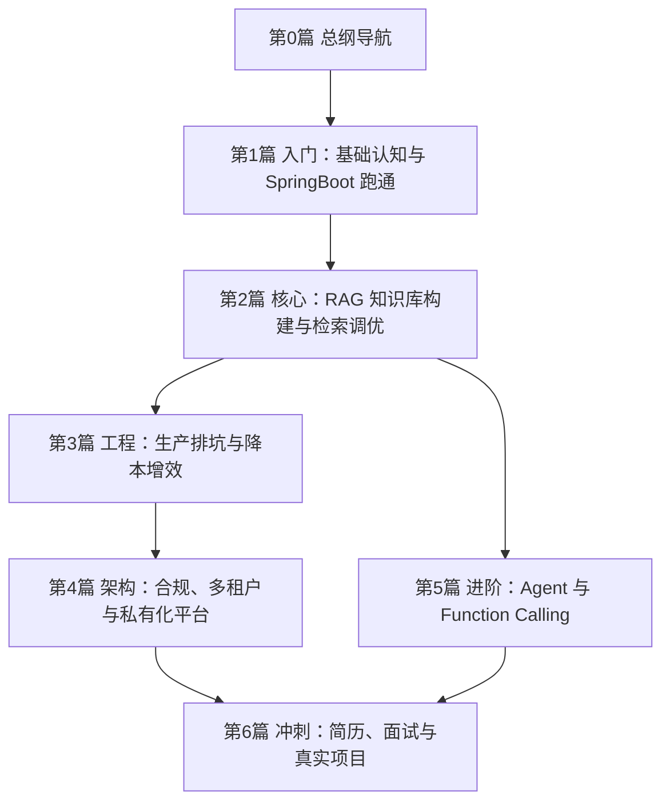

# 01 总览与路线：Java+AI 转型与实战全景图
> 本文档为 Java+AI 转型与实战系列的总纲与导航。
目标：厘清 Java 程序员学 AI / 转 AI 的完整链路、模块顺序、学习路线与核心概念。
>

---

## 1. 全景导航
### 1.1 模块先后顺序

### 1.2 学习路线
| 阶段 | 目标 | 关键能力 | 对应模块 |
| --- | --- | --- | --- |
| 入门 | 能跑通大模型对话 | SpringBoot 对接、流式输出、多轮记忆 | 第1篇 |
| 核心 | 能做企业知识库 | 文档解析、切片、Milvus、混合检索、重排序 | 第2篇 |
| 工程 | 能上生产 | 限流降级熔断、SSE 稳定、降本、监控 | 第3篇 |
| 架构 | 能做平台 | 鉴权、合规、多租户、私有化 AI 平台 | 第4篇 |
| 进阶 | 能做智能体 | Function Calling、Agent、Graph、多 Agent | 第5篇 |
| 冲刺 | 能拿 offer | 简历包装、面试题库、完整项目 | 第6篇 |

---

## 2. Java+AI 能力地图
### 2.1 从 CURD 到 AI 应用工程师
AI 完整发展链路，从简单到智能：

1. **LLM**：能说话
2. **RAG**：有知识、不幻觉
3. **FunctionCall**：能调用单个 Java 函数
4. **ToolCall**：能编排多工具
5. **Skills**：有业务经验、会按流程干
6. **MCP**：标准连接、易集成
7. **Agent**：自主思考、自动完成任务

一句话总结：
**LLM 是大脑，RAG 是书本，FunctionCall 是手，ToolCall 是手臂，Skills 是经验，MCP 是神经，Agent 是完整的 AI 员工。**

### 2.2 AI 技术分层与 Java 类比
| AI 层 | 作用 | Java 后端类比 |
| --- | --- | --- |
| LLM 大语言模型 | AI 的大脑 | 接口服务 |
| RAG 检索增强 | 解决幻觉、知识过时 | 数据库 / 搜索引擎 |
| FunctionCall 函数调用 | 调用 Java 接口底层机制 | 单个方法调用 |
| ToolCall 工具调用 | 多工具编排 | 服务编排 |
| Skills 技能 | 业务流程变成可复用专家经验 | 业务手册 / 最佳实践 |
| MCP 协议 | 统一工具连接 | 统一接口规范 |
| Agent 智能体 | 自动干活 | 自动化流程引擎 |

### 2.3 LLM 天生三大缺陷
1. **幻觉**：胡说八道
2. **知识截止**：训练后不更新
3. **无执行能力**：不能查库、不能调接口

后续所有技术，都是为了补这三个缺陷。

<!-- 这是一个文本绘图，源码为：flowchart LR -->
    A[LLM 三大缺陷] --> B[幻觉]
    A --> C[知识截止]
    A --> D[无执行能力]
    B --> E[RAG]
    C --> E
    D --> F[Function Calling / Tool Calling]
    F --> G[Agent]
    E --> G -->

---

## 3. 转型路线与阶段
| 阶段 | 学习周期 | 薪资涨幅/年薪 | 岗位 | 核心能力 |
| --- | --- | --- | --- | --- |
| 入门级 AI 应用开发 | 1-2 个月 | 10%-20% | Java 开发（AI 方向） | 调 API、基础 RAG、集成现有系统 |
| 进阶级 AI 系统开发 | 3-6 个月 | 30%-50% | AI 应用开发工程师 | 生产级 RAG、高可用、合规、多端接入 |
| 高级 AI 解决方案架构师 | 6-12 个月 | 50W+ | AI 解决方案架构师 | 方案设计、多模型选型、成本管控、跨部门推动 |
| 资深 AI 平台架构师 | 1-2 年 | 80W+ | AI 平台架构师 | 企业级 AI 平台、分布式、算力调度、多租户 |

### 3.1 入门级 AI 应用开发（1-2 个月）
+ 熟练调用主流大模型 API，能实现基础 AI 对话功能
+ 理解 RAG 基本原理，能搭建简单知识库问答
+ 能把 AI 能力无缝集成到现有 Java 业务系统
+ 知识点：大模型基础概念、Java 对接通义千问/文心一言、LangChain4j 基础、RAG 最简实现
+ 实战项目：简单企业内部知识库问答

### 3.2 进阶级 AI 系统开发（3-6 个月）
+ 能独立开发完整生产级 RAG 知识库系统
+ 懂性能优化、高可用设计、合规管控
+ 知识点：RAG 深度优化、本地大模型部署与量化、企业级能力、多端接入
+ 实战项目：企业智能客服系统、内部知识库平台

### 3.3 高级 AI 解决方案架构师（6-12 个月）
+ 能根据业务需求设计完整 AI 落地方案
+ 懂多模型选型、成本管控、架构设计
+ 能跨部门推动项目落地，拿到可量化业务结果

### 3.4 资深 AI 平台架构师（1-2 年）
+ 能设计企业级统一 AI 平台
+ 懂分布式架构、算力调度、多模型管理
+ 能支撑全公司 AI 应用落地

---

## 4. 避坑指南：转型最容易走的 4 条弯路
1. **放弃 Java，去学 Python 卷算法**
从零卷算法卷不过科班，反而丢掉工程优势。正确方向：立足 Java 技术栈，走 AI 工程化落地路线。
2. **只会调 API，不做完整项目**
只会调 API 没有竞争力。正确方向：做完整生产级项目，加入高可用、权限、合规、性能优化。
3. **光学不练，收藏等于学会**
面试一问细节就露馅。正确方向：动手做完整智能客服项目，写进简历。
4. **盲目追新，丢了根基**
Java 工程能力是根基，AI 是增量能力。根基稳了，增量才有价值。

---

## 5. 面试高频考点概览
### 5.1 基础概念题
+ RAG 的完整流程是什么？
+ RAG 有哪些常见优化方法？
+ 流式输出怎么实现？
+ Function Calling 的执行流程是什么？

### 5.2 工程场景题
+ 大模型接口不稳定怎么处理？
+ 怎么做限流降级？
+ 怎么控制调用成本？
+ 怎么保证数据安全？
+ 怎么实现部门级权限隔离？

### 5.3 项目深挖题
+ 你做的项目准确率多少？
+ 遇到过最棘手的问题是什么？
+ 怎么解决的？
+ 如果再做一次你会怎么优化？

### 5.4 方案设计题
+ 给你一个业务场景，你怎么设计整体方案？
+ 怎么做内部知识库？
+ 怎么做智能客服？
+ 怎么做文档总结系统？

