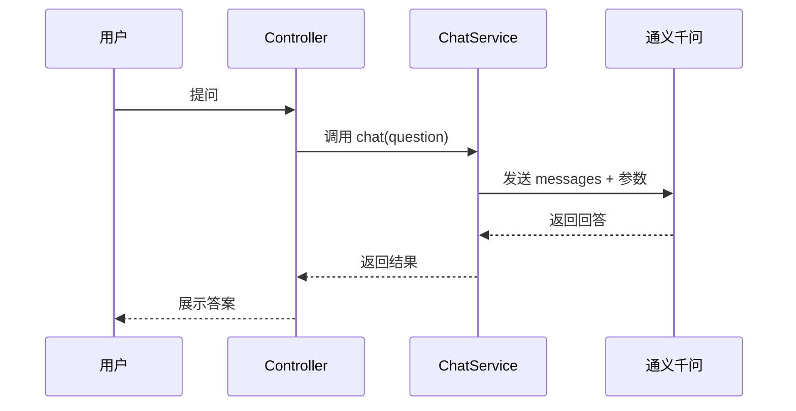

# 02 SpringBoot 接入：基础认知与快速跑通
> 本文档聚焦 Java+AI 入门：框架选型、SpringBoot 对接大模型、流式输出、多轮对话记忆、常用工具类、Starter 依赖整合。
>

---

## 1. 框架选型
## 1.1 AgentScope 框架简介
AgentScope Java 是阿里巴巴开源的 Agent 编程框架，用于构建基于大语言模型（LLM）的智能体应用。2.0 是一次较大规模的重构，核心定位是**智能体工程化**，在多 Agent 协同与生产底座方面能力突出[reference:0]。

AgentScope Java 需要 JDK 17 及以上版本，构建工具推荐 Maven 3.9+。推荐的入口是 `HarnessAgent`，它把工作区、长期记忆、会话持久化、子 agent、沙箱等工程能力打包在一个 builder 里[reference:1]。

核心依赖：

```xml
<dependency>
  <groupId>io.agentscope</groupId>
  <artifactId>agentscope-harness</artifactId>
  <version>${agentscope.version}</version>
</dependency>
```

如果只需要裸 ReActAgent 的框架 API（不需要工作区/持久化/子 agent/沙箱）， 足够提供 agent 本身。特定模型提供商的 Chat Model 与 formatter 位于独立的  模型扩展模块中。

HarnessAgent 快速示例：

```java
HarnessAgent agent = HarnessAgent.builder()
.name("note-taker")
.sysPrompt("你是一个帮助用户做笔记的助手。")
.model("dashscope:qwen-plus")
.workspace(Paths.get(".agentscope/workspace"))
.compaction(CompactionConfig.builder()
            .triggerMessages(30)
            .keepMessages(10)
            .build())
.build();

RuntimeContext ctx = RuntimeContext.builder()
.sessionId("demo-session")
.userId("alice")
.build();

agent.call(new UserMessage("我叫天宇，今天准备一个关于 ReAct 的技术分享。"), ctx).block();
agent.call(new UserMessage("我叫什么？我今天要干什么？"), ctx).block();
```

HarnessAgent 跑通三件事：工作区驱动的人格（AGENTS.md）、会话自动持久化（相同 sessionId 的第二轮记得第一轮）、对话压缩（超阈值后自动压缩 + 长期事实落到 MEMORY.md）。

## 1.2 四框架对比更新

| 框架 | 定位 | 核心优势 | 适用场景 |
| :--- | :--- | :--- | :--- |
| LangChain4j | 一站式大模型应用开发工具箱 | 组件最丰富、社区最成熟、生态最广 | 通用 Java AI 应用、RAG、工具调用 |
| Spring AI | Spring 官方 AI 集成框架 | Spring 生态原生集成、标准化强 | SpringBoot 3.x 项目 |
| AgentScope | 智能体工程化框架 | 多 Agent 协同、生产底座完善（沙箱、权限、审计）、原生支持多智能体 | 复杂多 Agent 业务系统、生产级 Agent |
| Dify | 低代码 AI 应用平台 | 快速验证、零代码 | 需求验证阶段、非技术团队 |


**选型原则**

1. **按 SpringBoot 版本与官方集成选型**
    - SpringBoot 3.x + 官方集成 → Spring AI
    - SpringBoot 2.x + 丰富 Agent/RAG → LangChain4j
    - 注意：Spring AI 与 LangChain4j 不要混用
2. **按业务场景与复杂度选型**
    - 快速原型 / 通用 RAG → LangChain4j 或 Spring AI
    - 复杂多 Agent 业务系统 → AgentScope
3. **按开发阶段选型**
    - PoC 阶段：LangChain4j 更适合快速搭建
    - 生产阶段：AgentScope 更适合复杂多 Agent 生产系统
    - 快速验证：Dify 适合低代码验证；生产级深度定制仍建议 Java 自研集成

> 踩坑提醒：LangChain4j 版本和 SpringBoot 版本必须对应，0.32.0 适配 SpringBoot 2.7.x，乱升版本会直接报 `NoSuchMethodError`。
>

---

## 2. 基础参数
+ **Prompt 结构化**：角色 + 指令 + 输出格式
+ **temperature**：0~1，越高越发散，越低越严谨
    - 0.2：知识库
    - 0.7：客服系统或问答系统
+ **max_tokens**：控制输出长度
+ **model**：按场景选择模型等级

---

## 3. SpringBoot 对接通义千问核心流程




### 3.1 核心依赖
```xml
<!-- LangChain4j 核心 -->
<dependency>
  <groupId>dev.langchain4j</groupId>
  <artifactId>langchain4j</artifactId>
  <version>0.31.0</version>
</dependency>
<!-- 通义千问适配 -->
<dependency>
  <groupId>dev.langchain4j</groupId>
  <artifactId>langchain4j-dashscope</artifactId>
  <version>0.31.0</version>
</dependency>
```

注意：0.31.0 是稳定版，新版本 API 变动较大，生产环境建议锁版本。

---

## 4. 流式输出 SSE
流式输出不是让大模型回复更快，而是让用户感知到“AI 正在回答”，减少等待焦虑。

常见方案对比：

| 方案 | 适合场景 | 推荐度 |
| :--- | :--- | :--- |
| 一次性返回字符串 | 简单 Demo、短答案 | ★ |
| SSE | 网页端、后台系统、企业应用 | ★★★★★ |
| WebSocket | 高并发聊天、IM | ★★★★ |
| 长轮询 | 兼容旧浏览器 | ★★ |


### 4.1 SSE 注意事项
1. **异步线程池配置**：避免占用请求线程导致超时阻塞。
2. **前端 EventSource 接收**：逐字追加 DOM。
3. **测试方式**：浏览器直接访问或 Apifox/Postman 使用 SSE 调试。
4. **常见坑**：
    - 大模型调用未开启 incrementalOutput(true)（核心。不开启的话，大模型还是会一次性返回）
    - 返回类型未写 produces = MediaType.TEXT_EVENT_STREAM_VALUE
    - 前端跨域
    - 超时时间太短
5. **真实项目还要考虑**：
    - 连接断开处理
    - 错误重试
    - 内容拼接
    - 代码块、Markdown 渲染
    - 权限校验、限流、配额、日志审计

### 4.2 前端 EventSource 示例
```javascript
const source = new EventSource('http://localhost:8080/api/chat/stream?message=用Java写一个冒泡排序');
source.onmessage = function(event) {
  const content = event.data;
  document.getElementById('answer').innerHTML += content;
};
source.onerror = function(error) {
  console.error('SSE连接失败', error);
  source.close();
};
```

### 4.3 超时设置
```java
SseEmitter emitter = new SseEmitter(60 * 1000L); // 60秒
```

### 4.4 WebFlux 和 SSE 如何选择
SSE 是一种**协议**（Server-Sent Events），WebFlux 是一种**编程模型**（响应式非阻塞）。两者不是互斥关系——WebFlux 可以用来实现 SSE，Spring MVC 也可以用 `SseEmitter` 实现 SSE。

| 维度 | Spring MVC + SseEmitter | WebFlux + Flux |
| :--- | :--- | :--- |
| 编程模型 | 命令式、同步阻塞 | 响应式、异步非阻塞 |
| 并发能力 | 低（每个连接占用一个线程） | 高（基于事件循环，Netty 驱动） |
| 资源占用 | 高 | 低 |
| 学习曲线 | 低，Java 开发者熟悉 | 高，需要理解 Reactor 范式 |
| 适用场景 | 本地调试、轻量级服务、已有 SpringMVC 项目 | 生产环境、高并发实时流处理、已有 WebFlux 技术栈 |
| 迁移成本 | 低 | 如果已有 SpringMVC 项目，切换成本高 |


**选型建议**：

+ 如果项目已有 SpringMVC 技术栈，**优先用 SseEmitter**，不要为了流式输出引入整个 WebFlux 依赖栈。
+ 如果系统本身就在用 WebFlux（如 Spring Cloud Gateway），**直接用 Flux** 集成成本最低。
+ 低并发（50 连接以内）时，两者表现几乎无差别，内存增长平稳，CPU 使用率均低于 5%。
+ 高并发场景（数百以上长连接），WebFlux 的资源优势才真正体现。
+ 务实做法：MVC + 薄接缝——核心逻辑与 web 传输解耦，核心只把 token 吐给一个最小的流式 sink 接口，web 层用薄适配桥到 `SseEmitter`。日后想换 WebFlux 只需改 web 层适配，核心逻辑不动。

---

## 5. 多轮对话记忆
本质：每次提问时，把历史聊天记录一起打包发给大模型。
核心逻辑：后端维护历史消息，每次全量传给大模型。剩下是存储介质、裁剪策略、过期策略的工程化优化。

### 5.1 新手必踩 4 坑
1. 只存用户消息，不存 AI 回复
2. 历史消息不裁剪，token 费用爆
3. sessionId 不隔离，不同用户串消息
4. 本地版部署到集群，会话丢失

### 5.2 生产优化
+ 按用户配额限制会话数
+ 摘要式长记忆
+ 敏感内容校验
+ 流式输出 + 对话记忆结合

#### 5.2.1 摘要式长记忆详解
**字数范围**：摘要控制在 **200 字以内**，代替完整历史上下文。实测可将 Token 消耗降低 80% 以上。

**使用什么模型压缩**：使用**便宜的小模型**（如通义千问 lite / qwen-turbo）做会话摘要，不用主力大模型，成本极低。

**摘要内容包含**：

+ 用户的核心意图和问题主题
+ AI 已给出的关键结论和数据
+ 未解决的待办事项或后续追问方向
+ 涉及的业务实体（用户ID、单据号、政策名称等）

**触发时机**：当会话长度超过预设阈值（如超过 8-10 轮或 Token 超过 3000）时，自动触发摘要压缩，用摘要替换原始历史消息。

---

## 6. 常用工具类

| 工具类 | 作用 |
| :--- | :--- |
| Token 计数工具 | 成本统计、上下文长度校验 |
| 文本清洗工具 | 去乱码、多余空格、换行、无效字符 |
| SSE 格式转换工具 | 统一事件格式、心跳保活 |
| Prompt 模板工具 | 统一管理提示词，支持变量填充 |
| 向量维度校验工具 | 避免入库时维度不匹配、全 0 向量 |


### 6.1 前置依赖
xml

```xml
<!-- Spring Web 基础依赖 -->
<dependency>
  <groupId>org.springframework.boot</groupId>
  <artifactId>spring-boot-starter-web</artifactId>
  <version>2.7.18</version>
</dependency>
<!-- JTokkit Token 计数库 -->
<dependency>
  <groupId>me.saro</groupId>
  <artifactId>jtokkit</artifactId>
  <version>1.0.0</version>
</dependency>
```

说明：文本清洗、Prompt 模板、向量校验三个工具类为纯 JDK 实现，无需第三方依赖。

### 6.2 Token 计数工具类
java

```java
public class TokenCountUtil {
    public static int countTokens(String text) {
        if (text == null || text.isEmpty()) return 0;
        return JTokkit.countTokens(text);
    }
    public static boolean isOverLimit(String text, int maxTokens) {
        return countTokens(text) > maxTokens;
    }
}
```

### 6.3 文本清洗工具类
java

```java
public class TextCleanUtil {
    public static String clean(String content) {
        if (content == null) return "";
        content = content.replaceAll("[\\t\\s]+", " ");
        content = content.replaceAll("\\n{3,}", "\n\n");
        content = content.replaceAll("机密|内部资料|第\\d+页共\\d+页", "");
        return content.trim();
    }
}
```

### 6.4 SSE 格式转换工具类
java

```java
public class SseUtil {
    public static void sendEvent(SseEmitter emitter, String content) {
        try {
            emitter.send(SseEmitter.event().name("message").data(content));
        } catch (Exception e) {
            throw new RuntimeException("SSE消息发送失败", e);
        }
    }
    public static void sendComplete(SseEmitter emitter) {
        try {
            emitter.send(SseEmitter.event().name("done").data("[DONE]"));
            emitter.complete();
        } catch (Exception e) {
            emitter.completeWithError(e);
        }
    }
    public static void sendHeartbeat(SseEmitter emitter) {
        try {
            emitter.send(SseEmitter.event().comment("heartbeat"));
        } catch (Exception e) {
            emitter.completeWithError(e);
        }
    }
}
```

### 6.5 Prompt 模板工具类
java

```java
public class PromptTemplateUtil {
    private static final String RAG_ANSWER_TEMPLATE =
    "你是企业内部智能客服，请仅基于以下参考文档回答用户问题。\n" +
    "如果参考文档中没有答案，请直接回复：暂无相关信息，请联系人工客服。\n\n" +
    "参考文档：\n{context}\n\n" +
    "用户问题：\n{question}";

    public static String getRagPrompt(String context, String question) {
        Map<String, String> params = new HashMap<>(2);
        params.put("context", context);
        params.put("question", question);
        return fillTemplate(RAG_ANSWER_TEMPLATE, params);
    }

    public static String fillTemplate(String template, Map<String, String> params) {
        String result = template;
        for (Map.Entry<String, String> entry : params.entrySet()) {
            result = result.replace("{" + entry.getKey() + "}", entry.getValue());
        }
        return result;
    }
}
```

### 6.6 向量维度校验工具类
java

```java
public class VectorValidateUtil {
    public static boolean validateDimension(float[] vector, int expectDimension) {
        if (vector == null || vector.length == 0) return false;
        return vector.length == expectDimension;
    }
    public static boolean isZeroVector(float[] vector) {
        if (vector == null || vector.length == 0) return true;
        for (float v : vector) {
            if (v != 0f) return false;
        }
        return true;
    }
}
```

---

## 7. 5 个 Starter 依赖整合

| 序号 | Starter | 用途 | 适用场景 |
| :--- | :--- | :--- | :--- |
| 1 | spring-ai-openai-spring-boot-starter | 大模型调用（OpenAI 兼容接口） | 通用大模型对话、Function Calling |
| 2 | langchain4j-spring-boot-starter | Agent 框架（RAG/Agent/记忆/工具） | 完整 Agent 应用开发 |
| 3 | milvus-sdk-java | 向量数据库 | RAG 知识库、长期记忆 |
| 4 | spring-boot-starter-webflux | 流式输出（SSE） | 大模型流式响应 |
| 5 | spring-boot-configuration-processor | 配置管理 | 大模型参数配置化 |


### 7.1 完整 pom.xml
```xml
<project>
  <modelVersion>4.0.0</modelVersion>
  <parent>
    <groupId>org.springframework.boot</groupId>
    <artifactId>spring-boot-starter-parent</artifactId>
    <version>3.2.5</version>
  </parent>
  <groupId>com.example</groupId>
  <artifactId>springboot-ai-starter</artifactId>
  <version>1.0.0</version>
  <properties>
    <java.version>17</java.version>
    <langchain4j.version>0.35.0</langchain4j.version>
    <milvus.version>2.4.4</milvus.version>
  </properties>
  <dependencies>
    <!-- 1. Spring AI：大模型调用 -->
    <dependency>
      <groupId>org.springframework.ai</groupId>
      <artifactId>spring-ai-openai-spring-boot-starter</artifactId>
      <version>1.0.0</version>
    </dependency>
    <!-- 2. LangChain4j：Agent 框架 -->
    <dependency>
      <groupId>dev.langchain4j</groupId>
      <artifactId>langchain4j-spring-boot-starter</artifactId>
      <version>${langchain4j.version}</version>
    </dependency>
    <dependency>
      <groupId>dev.langchain4j</groupId>
      <artifactId>langchain4j-dashscope-spring-boot-starter</artifactId>
      <version>${langchain4j.version}</version>
    </dependency>
    <!-- 3. Milvus：向量数据库 -->
    <dependency>
      <groupId>io.milvus</groupId>
      <artifactId>milvus-sdk-java</artifactId>
      <version>${milvus.version}</version>
    </dependency>
    <!-- 4. WebFlux：流式输出 -->
    <dependency>
      <groupId>org.springframework.boot</groupId>
      <artifactId>spring-boot-starter-webflux</artifactId>
    </dependency>
    <!-- 5. 配置管理 -->
    <dependency>
      <groupId>org.springframework.boot</groupId>
      <artifactId>spring-boot-configuration-processor</artifactId>
      <optional>true</optional>
    </dependency>
    <!-- Web -->
    <dependency>
      <groupId>org.springframework.boot</groupId>
      <artifactId>spring-boot-starter-web</artifactId>
    </dependency>
    <!-- Lombok -->
    <dependency>
      <groupId>org.projectlombok</groupId>
      <artifactId>lombok</artifactId>
      <optional>true</optional>
    </dependency>
  </dependencies>
</project>
```

> **避坑提醒**：Spring AI 1.0.0 要求 SpringBoot 3.2+；如果还在用 SpringBoot 2.7，用 LangChain4j 更合适。
>

<script type="module">
  // 等待页面完全加载
  window.addEventListener('load', () => {
    // 1. 把 Jekyll 生成的 language-mermaid 类替换为 mermaid
    const mermaidBlocks = document.querySelectorAll('.language-mermaid');
    mermaidBlocks.forEach(block => {
      block.parentElement.classList.add('mermaid');
      // 隐藏原始的代码格式
      block.parentElement.style.backgroundColor = 'transparent';
      block.parentElement.style.border = 'none';
      block.style.display = 'none';
    });

    // 2. 动态引入 Mermaid 库
    import('https://cdn.jsdelivr.net/npm/mermaid@10/dist/mermaid.esm.min.mjs')
      .then((mermaidModule) => {
        const mermaid = mermaidModule.default;
        mermaid.initialize({
          startOnLoad: false, // 自己手动触发
          theme: 'default'
        });
        // 3. 强制渲染
        mermaid.run().catch(err => console.error('Mermaid 渲染失败:', err));
      });
  });
</script>