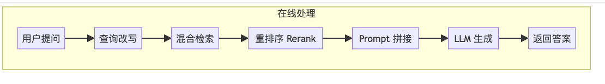
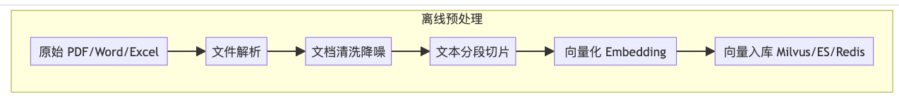
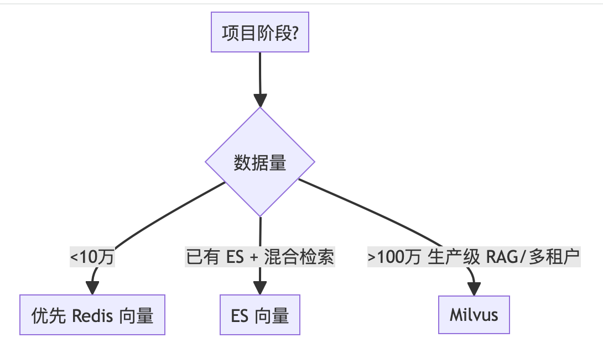
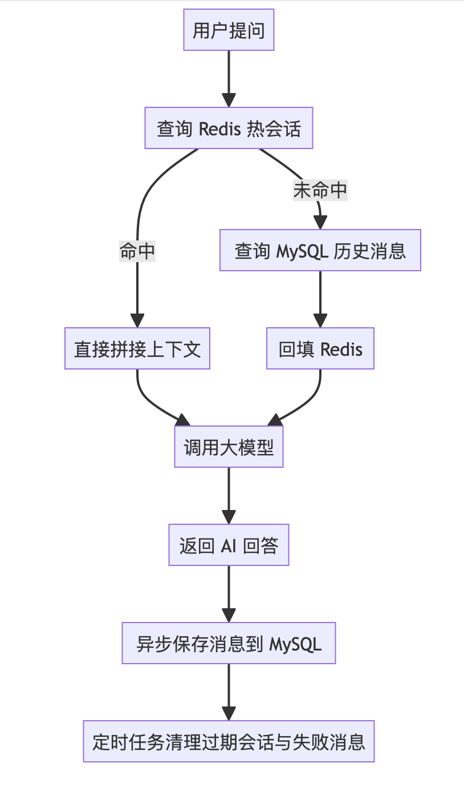

# 03 RAG 知识库：构建与检索调优
> 本文档聚焦 RAG 知识库全流程：文档解析、清洗、切片、向量库选型、Milvus 对接、检索优化、多轮会话存储选型、PDF 摘要。
>

---

## 1. RAG 是什么
RAG = Retrieval-Augmented Generation = 检索增强生成。
一句话：**给 LLM 开卷考试，杜绝幻觉，接入私有知识。**

普通大模型问答 = 闭卷考试，全靠 AI 脑子里的知识。
RAG 知识库问答 = 开卷考试，先给 AI 发参考资料，要求它只能照着资料答。

企业级 AI 落地最核心的两个卡点：**幻觉问题 + 数据安全问题**。

---

## 2. RAG 全流程
<!-- 这是一个文本绘图，源码为：flowchart TB -->




Java 后端逐行对应：

1. 文档加载 → 读文件
2. 文本切块 → 分页
3. 向量化 → 建索引
4. 向量库存储 → ElasticSearch / Redis / Milvus
5. 用户查询向量化 → 入参
6. 相似度检索 → 查库
7. Prompt 拼接 → 组装参数
8. LLM 生成 → 业务组装返回

---

## 3. 文档解析与清洗
### 3.1 技术选型
| 格式 | 解析工具 | 说明 |
| :--- | :--- | :--- |
| PDF | Apache PDFBox | 支持文本提取、加密 PDF |
| Word .docx | Apache POI | Office 标准工具 |
| Excel .xlsx | Apache POI | 单元格读取、表格转文本 |
| TXT | 原生 JDK | 直接读取 |


踩坑提醒：老格式 `.doc/.xls` 兼容性差，建议统一转 `.docx/.xlsx`。

### 3.2 企业级 RAG 离线预处理流程
<!-- 这是一个文本绘图，源码为：flowchart LR -->


清洗是承上启下的核心环节，低成本、高收益。
70% 的 RAG 召回准确率低下问题，根源不在 Milvus、不在 Embedding 模型，而是原始文档混入大量无效噪声。

### 3.3 常见清洗点
+ PDF 页眉页脚自动过滤
+ 纯页码行过滤
+ Word 表格结构化提取
+ 通用无效内容正则过滤
+ OCR 扫描版 PDF 处理

### 3.4 实测效果
+ 无效向量减少约 28%
+ 召回无关片段概率下降 35%
+ 幻觉频次明显减少

### 3.5 注意
+ 不要过度清洗
+ OCR 扫描版 PDF 不适用简单行过滤

---

## 4. 切片策略
| 策略 | 准确率 | 切分速度 | 适用场景 |
| :--- | :--- | :--- | :--- |
| 固定长度 | ★★☆ | ★★★★★ | 短文本、FAQ |
| 重叠窗口 | ★★★ | ★★★★ | 通用文档、博客（默认推荐） |
| 标题层级 | ★★★★ | ★★★★ | Markdown、API 文档 |
| 语义切分 | ★★★★★ | ★★ | 长文、论文（离线用） |
| 父子文档 | ★★★★★ | ★★★ | 企业知识库、长文档（生产首选） |


中文场景建议：

+ 普通制度、办公文档：chunk size 450-550 字符，重叠率 10%
+ 表格、短条文：250-350 字符，重叠率 15%
+ 长文、技术文档：600-800 字符，重叠率 10%

> 小技巧：切片大小不是固定的，短文档可以切小一点，长文档可以切大一点。中文场景建议 400-600 字符，重叠率 10%，检索效果最好。
>

### 4.1 策略1：固定长度切分
**定义**：按固定字符数切割，最简单但最容易踩坑。优点是实现简单、速度快，缺点是把完整句子、段落从中间切断，破坏语义完整性。

**代码**：

```java
public class FixedLengthSplitter {
    private final int chunkSize;
    private final int overlap;

    public FixedLengthSplitter(int chunkSize, int overlap) {
        this.chunkSize = chunkSize;
        this.overlap = overlap;
    }

    public List<String> split(String text) {
        List<String> chunks = new ArrayList<>();
        int start = 0;
        while (start < text.length()) {
            int end = Math.min(start + chunkSize, text.length());
            chunks.add(text.substring(start, end));
            start += chunkSize - overlap;
        }
        return chunks;
    }
}
```

**适用场景**：纯文本、结构简单的文档，如 FAQ、短公告。
**不适用**：长文档、技术文档、合同等有完整语义单元的内容。
**避坑**：一定要加 overlap，建议设为 chunkSize 的 10%-20%，否则相邻切片的上下文会断裂。

### 4.2 策略2：重叠窗口切分
**定义**：在固定长度基础上，优先在句号、换行符等自然边界处切割，尽量保持语义完整。比纯固定长度切分检索准确率提升 15%-20%。

**代码**：

```java
public class OverlapWindowSplitter {
    private final int chunkSize;
    private final int overlap;
    private static final String[] BOUNDARIES = {"\n\n", "\n", "。", "！", "？", ";", "；"};

    public OverlapWindowSplitter(int chunkSize, int overlap) {
        this.chunkSize = chunkSize;
        this.overlap = overlap;
    }

    public List<String> split(String text) {
        List<String> chunks = new ArrayList<>();
        int start = 0;
        while (start < text.length()) {
            int idealEnd = Math.min(start + chunkSize, text.length());
            int end = findNearestBoundary(text, idealEnd);
            if (end <= start) end = idealEnd;
            chunks.add(text.substring(start, end).trim());
            start = end - overlap;
            if (start >= text.length()) break;
        }
        return chunks;
    }

    private int findNearestBoundary(String text, int position) {
        int searchRange = 100;
        for (int i = 0; i < searchRange; i++) {
            if (position - i >= 0 && isBoundary(text, position - i)) return position - i;
            if (position + i < text.length() && isBoundary(text, position + i)) return position + i;
        }
        return position;
    }

    private boolean isBoundary(String text, int pos) {
        for (String b : BOUNDARIES) {
            if (text.startsWith(b, pos)) return true;
        }
        return false;
    }
}
```

**适用场景**：通用文档、技术博客、产品手册，是大多数 RAG 项目的默认选择。

### 4.3 策略3：按标题层级切分
**定义**：对于有明确标题层级的文档（Markdown、HTML、技术文档），按标题结构切分是准确率最高的方式。每个标题下的内容作为一个语义单元，天然完整。

**代码**：

```java
public class HeadingSplitter {
    public List<DocumentChunk> split(String markdownText) {
        List<DocumentChunk> chunks = new ArrayList<>();
        String[] lines = markdownText.split("\n");
        StringBuilder currentContent = new StringBuilder();
        String currentHeading = "引言";

        for (String line : lines) {
            if (line.startsWith("#")) {
                if (currentContent.length() > 0) {
                    chunks.add(new DocumentChunk(currentHeading, currentContent.toString().trim()));
                    currentContent = new StringBuilder();
                }
                currentHeading = line.replaceAll("#+\\s*", "").trim();
            } else {
                currentContent.append(line).append("\n");
            }
        }
        if (currentContent.length() > 0) {
            chunks.add(new DocumentChunk(currentHeading, currentContent.toString().trim()));
        }
        return chunks;
    }

    public static class DocumentChunk {
        private String heading;
        private String content;
        public DocumentChunk(String heading, String content) {
            this.heading = heading;
            this.content = content;
        }
        public String getHeading() { return heading; }
        public String getContent() { return content; }
    }
}
```

**关键技巧**：切分后把标题拼进内容里再向量化，如 `chunkForEmbedding = heading + "\n" + content`，这样检索时标题的语义权重会被保留，准确率大幅提升。

**适用场景**：Markdown 文档、帮助中心、API 文档、有明确章节结构的技术文档。
**不适用**：纯文本、无结构的长文。

### 4.4 策略4：语义切分
**定义**：最智能的切分方式——把文档拆成句子，计算相邻句子的 Embedding 相似度，相似度骤降的地方就是语义边界，在那里切分。

**代码**：

```java
public class SemanticSplitter {
    private final EmbeddingService embeddingService;
    private final double threshold;

    public SemanticSplitter(EmbeddingService embeddingService, double threshold) {
        this.embeddingService = embeddingService;
        this.threshold = threshold;
    }

    public List<String> split(String text) {
        List<String> sentences = splitToSentences(text);
        if (sentences.size() <= 1) return Collections.singletonList(text);

        List<List<Float>> vectors = sentences.stream()
        .map(embeddingService::embed)
        .collect(Collectors.toList());

        List<String> chunks = new ArrayList<>();
        StringBuilder currentChunk = new StringBuilder(sentences.get(0));

        for (int i = 1; i < sentences.size(); i++) {
            double sim = cosineSimilarity(vectors.get(i - 1), vectors.get(i));
            if (sim < threshold) {
                chunks.add(currentChunk.toString().trim());
                currentChunk = new StringBuilder(sentences.get(i));
            } else {
                currentChunk.append(sentences.get(i));
            }
        }
        chunks.add(currentChunk.toString().trim());
        return chunks;
    }

    private List<String> splitToSentences(String text) {
        return Arrays.asList(text.split("(?<=[。！？!?])"));
    }

    private double cosineSimilarity(List<Float> v1, List<Float> v2) {
        double dot = 0, norm1 = 0, norm2 = 0;
        for (int i = 0; i < v1.size(); i++) {
            dot += v1.get(i) * v2.get(i);
            norm1 += v1.get(i) * v1.get(i);
            norm2 += v2.get(i) * v2.get(i);
        }
        return dot / (Math.sqrt(norm1) * Math.sqrt(norm2));
    }
}
```

**适用场景**：长文、论文、报告、语义变化频繁的内容。
**缺点**：需要调用 Embedding 接口，切分速度慢，成本高，建议离线预处理时用。
**建议阈值**：0.7-0.8，根据文档类型调试。

### 4.5 策略5：父子文档（Parent-Child）
**定义**：切两层——父文档（大段完整内容，用于给大模型生成答案）+ 子文档（小段细粒度内容，用于向量检索）。检索时先查子文档，找到命中的子文档后，返回它对应的完整父文档给大模型。比单级切分准确率再提升 10%-15%。

**代码**：

```java
public class ParentChildSplitter {
    private final int parentSize;
    private final int childSize;

    public ParentChildSplitter(int parentSize, int childSize) {
        this.parentSize = parentSize;
        this.childSize = childSize;
    }

    public List<ParentChunk> split(String text) {
        List<ParentChunk> result = new ArrayList<>();
        List<String> parents = fixedSplit(text, parentSize);

        for (int pIdx = 0; pIdx < parents.size(); pIdx++) {
            String parentText = parents.get(pIdx);
            String parentId = "parent_" + pIdx;
            List<String> children = fixedSplit(parentText, childSize);
            List<ChildChunk> childChunks = new ArrayList<>();
            for (int cIdx = 0; cIdx < children.size(); cIdx++) {
                childChunks.add(new ChildChunk(
                    "child_" + pIdx + "_" + cIdx,
                    parentId,
                    children.get(cIdx)
                ));
            }
            result.add(new ParentChunk(parentId, parentText, childChunks));
        }
        return result;
    }

    private List<String> fixedSplit(String text, int size) {
        List<String> list = new ArrayList<>();
        for (int i = 0; i < text.length(); i += size) {
            list.add(text.substring(i, Math.min(i + size, text.length())));
        }
        return list;
    }
}
```

**检索流程**：

1. 用户问题 → 向量化 → 检索子文档库 → 拿到 TopK 子文档
2. 根据子文档的 parentId 去重，找到对应的父文档
3. 把完整父文档送入大模型生成答案

**适用场景**：长文档、法律合同、技术手册、企业知识库，是生产环境最推荐的方案。

---

## 5. 向量库选型
| 方案 | 优势 | 劣势 | 适用场景 |
| :--- | :--- | :--- | :--- |
| InMemory 内存库 | 零依赖、开箱即用 | 重启丢数据、容量小 | Demo、本地测试 |
| PGVector | 基于 PostgreSQL，不用额外运维 | 性能一般，百万级以上慢 | 中小规模、已有 PG |
| Elasticsearch | 全文检索 + 向量检索，运维成熟 | 向量性能弱，资源消耗高 | 已有 ES、混合检索 |
| Milvus | 专为向量设计，性能最强，支持分布式 | 需单独部署运维 | 大规模知识库、生产高并发 |
| Redis Stack 向量 | 极轻，基于现有 Redis | 弱，十万级内轻量 | 原型验证、缓存级向量 |


### 5.1 决策树


> 避坑提醒：不要为了「技术先进」盲目上 Milvus。十万级数据用 Redis 完全够用，运维成本差一个数量级。
>

---

## 6. Milvus 部署与对接
Milvus 是开源云原生向量数据库，支持大规模分布式部署、数据持久化、混合查询。

### 6.1 单机部署常见坑
1. 端口映射不全：19530、9091、3000
2. 向量维度创建后不能改
3. 没挂载持久化卷，重启数据全丢
4. 内存给太小，导入数据 OOM
5. 索引类型选错，检索又慢又不准
6. 相似度度量类型选错，召回结果不对
7. 重启后集合没加载，查询报错

### 6.2 内存经验值
| 向量数据量 | 建议内存 |
| :--- | :--- |
| 10 万条以内 | 4G 起步 |
| 100 万条左右 | 8G 起步 |
| 100 万条以上 | 16G 起步 |
| 生产环境 | 32G 起更稳 |


### 6.3 索引选择
| 数据量 | 推荐索引 |
| :--- | :--- |
| 10 万条以内 | FLAT |
| 10万–100万 | IVF_FLAT |
| 100 万以上 | HNSW |


### 6.4 相似度度量
| 场景 | 推荐度量类型 |
| :--- | :--- |
| 文本 Embedding 向量检索 | COSINE（余弦相似度） |
| 向量已做归一化，追求速度 | IP（内积） |
| 图像、空间距离类场景 | L2（欧氏距离） |


### 6.5 向量存储配置
```java
@Bean
public EmbeddingStore<TextSegment> embeddingStore() {
    return MilvusEmbeddingStore.builder()
    .host("localhost")
    .port(19530)
    .collectionName("rag_knowledge_base")
    .dimension(4096)
    .indexType(IndexType.IVF_FLAT)
    .metricType(MetricType.COSINE)
    .build();
}
```

划重点：dimension 参数是 90% 的人踩坑的地方，必须和嵌入模型输出维度完全一样，差一位都会直接报错创建集合失败。

### 6.6 可视化管理工具 Attu
Attu 是 Milvus 官方开源的一体化管理工具，提供直观的图形用户界面（GUI），可以轻松与数据库交互[reference:6]。和 MySQL 有 Navicat 一样，Attu 方便查看集合、查数据、管理索引。

**Attu 3.0 Beta 新增能力**：

+ 多集群管理：单侧边栏连接多个 Milvus 实例，一键切换
+ 本地状态持久化：容器重启后保留连接状态
+ 内置 AI 代理：含 50 多种 Milvus 工具
+ 专家级诊断能力：4 项内置诊断技能
+ 重新设计的数据浏览器：数据库 → 集合 → 分区 层级式树状结构
+ 内置 Prometheus 指标仪表板
+ API 调试平台
+ GUI 备份与还原（支持 S3、MinIO、GCS、Azure）
+ 简化的 RBAC 工作流[reference:7]

**Docker 部署**：

```bash
docker run -p 8000:3000 -e MILVUS_URL=127.0.0.1:19530 zilliz/attu:v2.3.0
```

启动后访问 http://localhost:8000 即可可视化管理 Milvus。

**与 Milvus 一起用 Docker Compose 部署**：

```yaml
services:
  attu:
    image: zilliz/attu:v2.3.0
    ports:
      - "8000:3000"
    environment:
      MILVUS_URL: milvus-standalone:19530
    depends_on:
      - standalone
```

### 6.7 常见模型维度参考
| 模型 | 维度 |
| :--- | :--- |
| 通义 text-embedding-v2 | 1536 |
| bge-small-zh | 1024 |
| bge-large-zh | 1024 |
| text-embedding-ada-002 | 1536 |


---

## 7. RAG 检索优化 5 技巧
RAG 铁律：**检索是上限，大模型是下限。**

1. **中文专属切片优化**：零成本，见效最快。
2. **接入重排序模型 Rerank**：效果提升最显著。
3. **关键词 + 向量混合检索**：解决专有名词匹配难题。
4. **生产级提示词模板优化**：零成本，直接抄。
5. **动态相似度阈值与 TopK**：避免无效内容混入。

### 7.1 生产级 RAG 提示词模板
```plain
【角色设定】你是专业的企业知识库助手，只能基于提供的参考文档回答问题，严禁编造任何内容。
【参考文档】{{context}}
【回答规则】
1. 答案必须100%来自参考文档，不得添加任何文档外的信息、推测、补充
2. 如果参考文档中没有相关内容，直接回答：「暂无相关资料，请补充文档后再提问」
3. 优先分点作答，逻辑清晰，保留文档中的数字、标准、限定条件
4. 不得使用「根据文档」「参考资料显示」这类前缀，直接输出答案
【用户问题】{{question}}
```

### 7.2 动态相似度阈值与 TopK
+ 短问题、精确问题：阈值调高到 0.75，Top2
+ 长问题、开放性问题：阈值调低到 0.65，Top5
+ 没有达到阈值的内容：直接丢弃

默认配置：Top3，相似度阈值 0.7。

### 7.3 新手必踩 5 坑
1. 所有文档一刀切，用同一个切片参数
2. 重排序召回太少，没东西可排
3. 混合检索权重乱调，反而引入噪音
4. 提示词留了发挥空间，AI 疯狂脑补
5. 阈值设太低，什么内容都往里塞

---

## 8. AI 多轮会话存储选型
纯 Redis 不是生产标准答案，纯 MySQL 也不是。
真正靠谱方案：**Redis + MySQL 混合存储**。

### 8.1 架构图


### 8.2 核心表
+ chat_session：会话表
+ chat_message：消息明细表

### 8.3 生产问题
+ Redis 和 MySQL 数据不一致
+ 异步落库失败导致会话丢失
+ 缓存过期后历史上下文断档
+ 消息顺序乱掉
+ 同一 sessionId 出现多轮重复上下文

### 8.4 解决
+ 活跃会话优先读 Redis
+ 缓存未命中回查 MySQL
+ 消息写入后双写最终一致
+ 启动补偿任务
+ 会话不能无限长，超长会话摘要

---

## 9. PDF 智能摘要
### 9.1 核心难点
1. 长文档超限
2. 摘要遗漏前半部分
3. 业务需求不统一

### 9.2 方案：MapReduce 思路
+ Map：长文档切段，每段单独生成摘要
+ Reduce：合并所有分段摘要，生成总摘要

### 9.3 优化
+ 按章节边界切分
+ 分级摘要
+ 缓存摘要结果

### 9.4 可写进简历的项目描述
> 设计并实现企业文档智能摘要模块，基于 LangChain4j + PDFBox，采用分段摘要 + 合并总摘要的 MapReduce 方案解决长文档上下文超限问题；支持合同/报告/通用三种定制摘要模板，单份 50 页文档处理时间从 15 分钟降至 30 秒，法务/产品团队审阅效率提升 90%。
>

