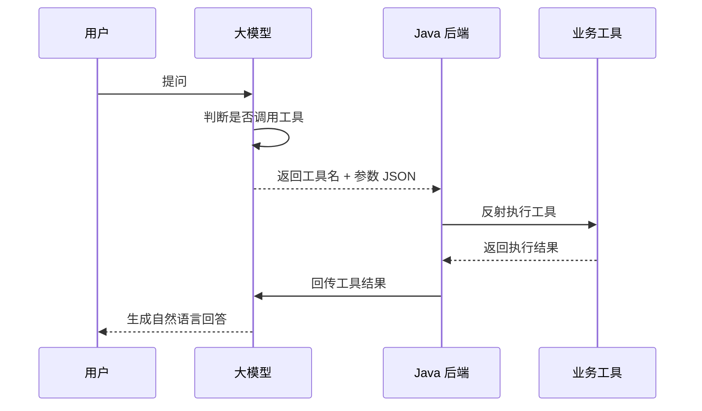

# 04 Agent 与 Function Calling：从工具调用到多智能体协作
> 本文档聚焦 Function Calling、Tool Calling、Agent、ReAct、三层记忆、Plan-and-Execute、Graph 工作流、多 Agent 协作及生产踩坑。
>

---

## 1. Function Calling 与 Tool Calling
Function Call = 函数调用 = LLM 生成结构化指令，调用外部函数。
一句话：给 LLM 装“手”，让它调用你的 Java 方法。

Tool Call = 工具调用 = 多工具、多步骤、智能编排。
Function Call 是单步调用，Tool Call 是系统级能力编排。

### 1.1 区别
| 维度 | Function Call | Tool Call |
| :--- | :--- | :--- |
| 层级 | 机制层 | 系统层 |
| 能力 | 单函数调用，JSON 输出 | 多工具、多步骤、循环调用、决策选择 |
| 关系 | Tool Call 的底层实现 | Function Call 的升级版 |


---

### 1.2 Function Calling（机制层）
#### 1.2.1 完整流程




完整流程只有 4 步：

1. 用户提问：比如“帮我查一下订单号 20240601 的物流状态”
2. 意图判断：大模型识别用户需要调用「查询订单物流」工具，生成结构化参数（订单号 = 20240601）
3. 后端执行：Java 服务拿到工具名和参数，真实调用业务接口 / 数据库，拿到执行结果
4. 整理返回：把执行结果喂给大模型，让它整理成自然语言回答用户

关键点：**大模型不执行任何代码，它只做决策——决定调什么工具、传什么参数。执行是你后端的事，所以生产级的容错全在你这边。**

#### 1.2.2 完整代码案例
**第一步：定义工具注解**

```java
@Target(ElementType.METHOD)
@Retention(RetentionPolicy.RUNTIME)
public @interface FunctionTool {
    String name();
    String description();
    String parameters();
    long timeoutMs() default 30000;
    int maxRetry() default 2;
    boolean critical() default false;
}
```

**第二步：定义业务工具**

```java
@Component
public class BusinessTools {

    @Autowired
    private EmployeeMapper employeeMapper;

    @Autowired
    private OrderApiService orderApiService;

    /**
     * 工具1：查询员工剩余年假
     */
    @FunctionTool(
        name = "query_annual_leave",
        description = "查询指定员工的剩余年假天数。当用户询问年假、休假、调休时使用此工具。" +
                      "当用户询问实时信息或通用常识时，不要使用此工具。",
        parameters = "{\"type\":\"object\",\"properties\":{" +
                     "\"employeeName\":{\"type\":\"string\"," +
                     "\"description\":\"员工姓名或员工工号\"}}," +
                     "\"required\":[\"employeeName\"]}",
        timeoutMs = 5000,
        maxRetry = 1,
        critical = false
    )
    public ToolResult queryAnnualLeave(String argumentsJson) {
        JSONObject args = JSON.parseObject(argumentsJson);
        String employeeName = args.getString("employeeName");
        try {
            Double leaveDays = employeeMapper.selectLeaveDaysByName(employeeName);
            return new ToolResult(true, "员工" + employeeName + "剩余年假：" + leaveDays + "天");
        } catch (Exception e) {
            return new ToolResult(false, "查询失败：未找到该员工信息");
        }
    }

    /**
     * 工具2：查询订单物流状态
     */
    @FunctionTool(
        name = "query_order_logistics",
        description = "查询指定订单的物流状态。当用户询问快递、物流、发货、到货时使用此工具。",
        parameters = "{\"type\":\"object\",\"properties\":{" +
                     "\"orderNo\":{\"type\":\"string\"," +
                     "\"description\":\"订单号\"}}," +
                     "\"required\":[\"orderNo\"]}",
        timeoutMs = 10000,
        maxRetry = 2,
        critical = false
    )
    public ToolResult queryOrderLogistics(String argumentsJson) {
        JSONObject args = JSON.parseObject(argumentsJson);
        String orderNo = args.getString("orderNo");
        try {
            String logisticsInfo = orderApiService.getLogistics(orderNo);
            return new ToolResult(true, logisticsInfo);
        } catch (Exception e) {
            return new ToolResult(false, "查询失败：订单号不存在");
        }
    }
}
```

**第三步：工具注册中心**

```java
@Component
public class FunctionRegistry implements BeanPostProcessor {

    private final Map<String, FunctionMethod> functions = new ConcurrentHashMap<>();

    @Override
    public Object postProcessAfterInitialization(Object bean, String beanName) throws BeansException {
        for (Method method : bean.getClass().getMethods()) {
            FunctionTool annotation = method.getAnnotation(FunctionTool.class);
            if (annotation != null) {
                register(annotation.name(), annotation.description(),
                        annotation.parameters(), annotation, bean, method);
                log.info("注册Agent工具: {} - {}", annotation.name(), annotation.description());
            }
        }
        return bean;
    }

    private void register(String name, String description, String parameters,
                          FunctionTool annotation, Object instance, Method method) {
        if (functions.containsKey(name)) {
            log.warn("工具名重复: {}，将被覆盖", name);
        }
        functions.put(name, new FunctionMethod(name, description, parameters, annotation, instance, method));
    }

    public FunctionMethod get(String name) {
        return functions.get(name);
    }

    /**
     * 获取所有工具定义（转为大模型需要的格式）
     */
    public List<JSONObject> getToolDefinitions() {
        List<JSONObject> list = new ArrayList<>();
        for (FunctionMethod fm : functions.values()) {
            JSONObject tool = new JSONObject();
            tool.put("type", "function");
            JSONObject function = new JSONObject();
            function.put("name", fm.getName());
            function.put("description", fm.getDescription());
            function.put("parameters", JSON.parseObject(fm.getParameters()));
            tool.put("function", function);
            list.add(tool);
        }
        return list;
    }

    public static class FunctionMethod {
        private String name;
        private String description;
        private String parameters;
        private FunctionTool annotation;
        private Object instance;
        private Method method;

        public FunctionMethod(String name, String description, String parameters,
                              FunctionTool annotation, Object instance, Method method) {
            this.name = name;
            this.description = description;
            this.parameters = parameters;
            this.annotation = annotation;
            this.instance = instance;
            this.method = method;
        }

        public String getName() { return name; }
        public String getDescription() { return description; }
        public String getParameters() { return parameters; }
        public FunctionTool getAnnotation() { return annotation; }
        public Method getMethod() { return method; }
        public Object getInstance() { return instance; }
    }
}
```

**第四步：工具执行器（生产级）**

```java
@Slf4j
@Component
public class FunctionExecutor {

    @Resource
    private FunctionRegistry registry;

    private final ThreadPoolExecutor executor = new ThreadPoolExecutor(
            10, 50, 60, TimeUnit.SECONDS,
            new LinkedBlockingQueue<>(200),
            r -> { Thread t = new Thread(r, "function-executor"); t.setDaemon(true); return t; },
            new ThreadPoolExecutor.CallerRunsPolicy()
    );

    /**
     * 执行工具调用：参数校验 + 超时控制 + 失败重试 + 结果截断 + 分级降级
     */
    public ToolResult execute(String toolName, String argumentsJson) {
        FunctionRegistry.FunctionMethod function = registry.get(toolName);
        if (function == null) {
            return ToolResult.fail("工具不存在: " + toolName);
        }

        // 参数校验
        ValidationResult validation = validateParams(function, argumentsJson);
        if (!validation.isValid()) {
            return ToolResult.fail("参数校验失败: " + validation.getErrorMsg()
                    + "，请修正参数后重新调用。正确的参数格式: " + function.getParameters());
        }

        // 带超时+重试执行
        int maxRetry = function.getAnnotation().maxRetry();
        for (int attempt = 1; attempt <= maxRetry + 1; attempt++) {
            try {
                return executeWithTimeout(function, argumentsJson, function.getAnnotation().timeoutMs());
            } catch (TimeoutException e) {
                log.warn("工具[{}]执行超时，第{}次尝试", toolName, attempt);
                if (attempt <= maxRetry) continue;
                return handleFailure(function, "工具执行超时（" + function.getAnnotation().timeoutMs() + "ms）");
            } catch (Exception e) {
                log.warn("工具[{}]执行异常，第{}次尝试: {}", toolName, attempt, e.getMessage());
                if (attempt <= maxRetry && isRetryable(e)) continue;
                return handleFailure(function, "工具执行异常: " + e.getMessage());
            }
        }
        return ToolResult.fail("工具执行失败");
    }

    private ToolResult executeWithTimeout(FunctionRegistry.FunctionMethod function,
                                           String argumentsJson, long timeoutMs) throws Exception {
        Future<ToolResult> future = executor.submit(() -> {
            try {
                Method method = function.getMethod();
                Object result = method.invoke(function.getInstance(), argumentsJson);
                return ToolResult.success(formatResult(result));
            } catch (Exception e) {
                throw e;
            }
        });
        return future.get(timeoutMs, TimeUnit.MILLISECONDS);
    }

    private ValidationResult validateParams(FunctionRegistry.FunctionMethod function, String argumentsJson) {
        try {
            JSONObject args = JSON.parseObject(argumentsJson);
            JSONObject schema = JSON.parseObject(function.getParameters());
            if (schema.containsKey("required")) {
                for (String required : schema.getJSONArray("required").toJavaList(String.class)) {
                    if (!args.containsKey(required) || args.getString(required).isEmpty()) {
                        return ValidationResult.fail("缺少必填参数: " + required);
                    }
                }
            }
            return ValidationResult.ok();
        } catch (Exception e) {
            return ValidationResult.fail("参数JSON格式错误: " + e.getMessage());
        }
    }

    private String formatResult(Object result) {
        if (result == null) return "执行成功，无返回数据";
        String str = result.toString();
        if (str.length() > 2000) {
            return str.substring(0, 2000) + "\n...（结果过长，已截断）";
        }
        return str;
    }

    private boolean isRetryable(Exception e) {
        String msg = e.getMessage() == null ? "" : e.getMessage();
        return msg.contains("timeout") || msg.contains("connect")
                || msg.contains("Connection refused") || e instanceof java.net.SocketException;
    }

    private ToolResult handleFailure(FunctionRegistry.FunctionMethod function, String errorMsg) {
        if (function.getAnnotation().critical()) {
            return ToolResult.fail("关键工具[" + function.getName() + "]执行失败: " + errorMsg
                    + "，无法继续完成任务，请告知用户。");
        } else {
            return ToolResult.fail("工具[" + function.getName() + "]执行失败: " + errorMsg
                    + "，可以尝试用其他方式回答用户问题，或告知用户该功能暂时不可用。");
        }
    }
}
```

**第五步：调用入口 —— 完整闭环**

```java
@Service
public class FunctionCallService {

    @Autowired
    private DashScope dashScope;

    @Autowired
    private FunctionRegistry functionRegistry;

    @Autowired
    private FunctionExecutor functionExecutor;

    public String chatWithTools(String userQuestion) {
        List<Message> messages = new ArrayList<>();
        messages.add(Message.builder().role(Role.SYSTEM)
                     .content("你是企业内部智能助手，优先使用工具回答用户问题，没有合适工具再直接回答。")
                     .build());
        messages.add(Message.builder().role(Role.USER).content(userQuestion).build());

        // 注册所有可用工具
        List<JSONObject> tools = functionRegistry.getToolDefinitions();

        GenerationRequest request = GenerationRequest.builder()
        .model("qwen-plus")
        .input(MessageInput.builder().messages(messages).build())
        .tools(tools)
        .toolChoice("auto")
        .resultFormat(ResultFormat.MESSAGE)
        .build();

        GenerationResult result = dashScope.call(request);
        ChatMessage responseMsg = result.getOutput().getChoices().get(0).getMessage();

        if (responseMsg.getToolCalls() != null && !responseMsg.getToolCalls().isEmpty()) {
            messages.add(responseMsg);

            for (ToolCall toolCall : responseMsg.getToolCalls()) {
                String toolName = toolCall.getFunction().getName();
                String toolArgs = toolCall.getFunction().getArguments();

                ToolResult toolResult = functionExecutor.execute(toolName, toolArgs);

                messages.add(Message.builder()
                             .role(Role.TOOL)
                             .toolCallId(toolCall.getId())
                             .content(toolResult.getData())
                             .build());
            }

            GenerationRequest secondRequest = GenerationRequest.builder()
            .model("qwen-plus")
            .input(MessageInput.builder().messages(messages).build())
            .resultFormat(ResultFormat.MESSAGE)
            .build();
            GenerationResult finalResult = dashScope.call(secondRequest);
            return finalResult.getOutput().getChoices().get(0).getMessage().getContent();
        }

        return responseMsg.getContent();
    }
}
```

---

### 1.3 Tool Calling（系统层）
#### 1.3.1 典型场景
**场景一：查订单 → 查用户 → 发短信（多 Tool 连续调用）**

用户问：“帮我查一下订单 20240601 的物流，到了通知我。”

大模型自主规划：

1. 调用 `query_order_logistics` 查物流
2. 调用 `query_user_phone` 获取用户手机号
3. 调用 `send_sms` 发送通知

三个工具存在依赖关系，必须串行执行。

**场景二：同时查天气和查新闻（无依赖并行调用）**

用户问：“今天北京天气怎么样？有什么科技新闻？”

大模型返回两个 tool_calls：

+ `get_weather(city=北京)`
+ `get_news(category=科技)`

两个工具无依赖，可用 `CompletableFuture` 并行执行，平均响应时间减少 40%。

**场景三：复杂任务自动编排**

用户问：“帮我准备明天的客户会议材料。”

大模型规划：查日程 → 查客户信息 → 查产品文档 → 生成会议摘要 → 发送提醒。

#### 1.3.2 多工具调度核心代码
**多工具调用和并行执行说明：**

+ 串行执行：有依赖关系的工具
+ 并行执行：无依赖关系的工具，用 CompletableFuture
+ 结果顺序回传：按 tool_call_id 顺序回传

```java
@Service
public class ToolCallService {

    @Autowired
    private FunctionExecutor functionExecutor;

    /**
     * 处理大模型返回的多个 tool_calls
     * 支持串行执行和并行执行
     */
    public List<ToolResult> executeToolCalls(List<ToolCall> toolCalls, boolean parallel) {
        if (parallel) {
            // 无依赖工具并行执行
            List<CompletableFuture<ToolResult>> futures = toolCalls.stream()
            .map(tc -> CompletableFuture.supplyAsync(() ->
                                                     functionExecutor.execute(
                                                         tc.getFunction().getName(),
                                                         tc.getFunction().getArguments())))
            .collect(Collectors.toList());

            CompletableFuture.allOf(futures.toArray(new CompletableFuture[0])).join();

            return futures.stream()
            .map(f -> {
                try { return f.get(); }
                catch (Exception e) { return ToolResult.fail(e.getMessage()); }
            })
            .collect(Collectors.toList());
        } else {
            // 有依赖工具串行执行
            List<ToolResult> results = new ArrayList<>();
            for (ToolCall tc : toolCalls) {
                ToolResult result = functionExecutor.execute(
                    tc.getFunction().getName(),
                    tc.getFunction().getArguments());
                results.add(result);
                if (!result.isSuccess()) break;
            }
            return results;
        }
    }

    /**
     * 将工具结果按 tool_call_id 顺序回传大模型
     */
    public List<ChatMessage> buildToolMessages(List<ToolCall> toolCalls, List<ToolResult> results) {
        List<ChatMessage> messages = new ArrayList<>();
        for (int i = 0; i < toolCalls.size(); i++) {
            ChatMessage msg = new ChatMessage("tool", results.get(i).getData());
            msg.setTool_call_id(toolCalls.get(i).getId());
            msg.setName(toolCalls.get(i).getFunction().getName());
            messages.add(msg);
        }
        return messages;
    }
}
```

---

### 1.4 通用生产级工程化（Function Call 与 Tool Call 共性）
#### 1.4.1 生产级四层架构
1. 工具定义层：名称 + 描述 + JSON Schema + 超时 + 重试
2. 工具执行层：参数校验、超时控制、失败重试、结果截断、分级降级
3. 循环防护层：最大轮次、防死循环、连续失败拦截
4. 多工具调度层：串行 / 并行执行，按 `tool_call_id` 回传

#### 1.4.2 工具定义 3 层信息
1. 元信息层：工具名称、描述、参数 JSON Schema
2. 执行配置层：超时时间、最大重试次数、是否关键工具
3. 结果处理层：结果格式化、结果长度超 2000 字符截断

#### 1.4.3 工具执行 5 个生产级机制
1. 参数校验
2. 超时控制
3. 失败重试（区分可重试异常）
4. 结果截断
5. 关键/非关键降级

#### 1.4.4 Agent 循环终止保护
1. 最大轮次限制：最多 10 轮推理
2. 重复调用检测：同一工具同样参数调 2 次未成功，停止
3. 连续失败检测：连续 3 次工具调用失败，终止任务

---

## 2. Agent 智能体
Agent = LLM + RAG + ToolCall + Skills + 记忆 + 规划。
一句话：能自主思考、自主调用工具、自主完成任务的 AI 员工。

### 2.1 Agent 核心循环（ReAct 框架）
1. Thought 思考：大模型分析用户意图，决定下一步做什么
2. Action 行动：调用工具 / API 执行具体操作
3. Observation 观察：获取工具执行结果
4. 回到 Thought，继续推理，直到任务完成

### 2.2 Java Agent 核心组件
| 组件 | 职责 | 对应角色 |
| :--- | :--- | :--- |
| LLMClient | 调用大模型，获取推理结果 | 大脑 |
| ToolRegistry | 注册和管理可用工具 | 工具箱 |
| AgentExecutor | 执行 ReAct 循环，协调 LLM 和工具 | 调度器 |
| AgentResponse | 封装最终回答 | 输出 |


### 2.3 ReAct Agent 完整 Java 实现
ReAct（Reasoning + Acting）是一种 Agent 执行框架，核心机制是“Reasoning-Action-Reflection”循环，即“思考-行动-观察”三步交替过程。它让 AI 像人类一样逐步推理并验证每一步结果，通过工具调用获取实时数据而非仅依赖训练数据。

```java
@Component
public class ReActAgentExecutor {

    @Resource
    private LLMClient llmClient;

    @Resource
    private FunctionRegistry functionRegistry;

    @Resource
    private FunctionExecutor functionExecutor;

    private static final int MAX_ITERATIONS = 10;

    public String execute(String userInput, String systemPrompt) throws Exception {
        List<LLMClient.ChatMessage> messages = new ArrayList<>();
        messages.add(new LLMClient.ChatMessage("system", systemPrompt));
        messages.add(new LLMClient.ChatMessage("user", userInput));

        for (int iteration = 0; iteration < MAX_ITERATIONS; iteration++) {
            // 1. Thought：大模型思考
            String responseJson = llmClient.chatWithTools(messages, functionRegistry.getToolDefinitions());
            JSONObject response = JSON.parseObject(responseJson);
            JSONObject message = response.getJSONArray("choices").getJSONObject(0).getJSONObject("message");

            // 2. 判断是否有 Action（工具调用）
            JSONArray toolCalls = message.getJSONArray("tool_calls");
            if (toolCalls == null || toolCalls.isEmpty()) {
                // 没有工具调用，说明大模型已经给出 Final Answer
                String finalAnswer = message.getString("content");
                messages.add(new LLMClient.ChatMessage("assistant", finalAnswer));
                return finalAnswer;
            }

            // 3. 有 Action，执行工具
            messages.add(new LLMClient.ChatMessage("assistant", message.getString("content")));

            for (int i = 0; i < toolCalls.size(); i++) {
                JSONObject toolCall = toolCalls.getJSONObject(i);
                String toolCallId = toolCall.getString("id");
                JSONObject function = toolCall.getJSONObject("function");
                String toolName = function.getString("name");
                String arguments = function.getString("arguments");

                // 4. Observation：执行工具，观察结果
                FunctionExecutor.ToolResult result = functionExecutor.execute(toolName, arguments);

                LLMClient.ChatMessage toolMsg = new LLMClient.ChatMessage("tool", result.getData());
                toolMsg.setTool_call_id(toolCallId);
                toolMsg.setName(toolName);
                messages.add(toolMsg);
            }
            // 5. 回到循环开头，大模型根据工具结果继续推理
        }

        return "抱歉，任务复杂度超出处理能力（已达到最大推理轮次），请简化问题后重试。";
    }
}
```

关键点：

+ 每次循环先让大模型“思考”（Thought），判断是否需要调用工具
+ 如果需要，执行工具并获取结果（Action → Observation）
+ 把工具结果回传给大模型，继续下一轮推理
+ 直到大模型不再调用工具（给出最终答案）或达到最大轮次

---

## 3. 三层记忆系统
| 记忆类型 | 作用 | 关键点 |
| :--- | :--- | :--- |
| 短期记忆 | 当前会话最近 N 轮对话 | 控制轮次上限，建议 8-12 轮 |
| 长期记忆 | 重要业务事实、用户偏好、历史决策向量化存入 Milvus | 跨会话持久化，相关性阈值过滤 |
| 实体记忆 | 用户 ID、租户、业务单据号等关键参数 | 结构化存储，防大模型幻觉篡改 |


### 3.1 三层记忆系统 Java 实现
**短期会话记忆**

```java
public class ShortTermMemory {
    private static final int MAX_ROUNDS = 10;
    private final Deque<Message> history = new ArrayDeque<>();

    public void addUserMessage(String content) { addMessage("user", content); }
    public void addAssistantMessage(String content) { addMessage("assistant", content); }

    private void addMessage(String role, String content) {
        history.offerLast(new Message(role, content));
        while (history.size() > MAX_ROUNDS) {
            history.pollFirst();
        }
    }

    public String buildContext() {
        if (history.isEmpty()) return "";
        StringBuilder sb = new StringBuilder("【历史对话】\n");
        for (Message msg : history) {
            sb.append(msg.role()).append(": ").append(msg.content()).append("\n");
        }
        return sb.toString();
    }

    public void clear() { history.clear(); }
    public record Message(String role, String content) {}
}
```

**长期向量记忆（Milvus + 通义千问 Embedding）**

```java
@Component
public class LongTermVectorMemory {

    @Value("${milvus.host:localhost}")
    private String milvusHost;

    @Value("${milvus.port:19530}")
    private int milvusPort;

    @Value("${llm.api-key}")
    private String apiKey;

    private static final int VECTOR_DIM = 1536;
    private static final String COLLECTION_NAME = "agent_long_term_memory";
    private static final float SIMILARITY_THRESHOLD = 0.65f;

    private MilvusServiceClient milvusClient;

    @PostConstruct
    public void init() {
        milvusClient = new MilvusServiceClient(ConnectParam.newBuilder()
                                               .withHost(milvusHost).withPort(milvusPort).build());
        ensureCollectionExists();
    }

    /**
     * 保存重要业务事实到向量库
     */
    public void saveFact(String tenantId, String userId, String fact) {
        try {
            List<Float> vector = embed(fact);
            List<InsertParam.Field> fields = new ArrayList<>();
            fields.add(new InsertParam.Field("tenant_id", Collections.singletonList(tenantId)));
            fields.add(new InsertParam.Field("user_id", Collections.singletonList(userId)));
            fields.add(new InsertParam.Field("content", Collections.singletonList(fact)));
            fields.add(new InsertParam.Field("vector", Collections.singletonList(vector)));

            milvusClient.insert(InsertParam.newBuilder()
                                .withCollectionName(COLLECTION_NAME)
                                .withFields(fields)
                                .build());
        } catch (Exception e) {
            throw new RuntimeException("保存长期记忆失败", e);
        }
    }

    /**
     * 根据当前 query 召回 TopN 相关记忆（带相关性阈值过滤和租户隔离）
     */
    public List<String> recall(String tenantId, String userId, String query, int topN) {
        try {
            List<Float> queryVector = embed(query);
            SearchParam searchParam = SearchParam.newBuilder()
            .withCollectionName(COLLECTION_NAME)
            .withVectorFieldName("vector")
            .withVectors(Collections.singletonList(queryVector))
            .withTopK(topN)
            .withExpr("tenant_id == \"" + tenantId + "\" AND user_id == \"" + userId + "\"")
            .build();

            SearchResultsWrapper wrapper = new SearchResultsWrapper(
                milvusClient.search(searchParam).getData().getResults());

            List<String> results = new ArrayList<>();
            for (Object record : wrapper.getRowRecords(0)) {
                SearchResultsWrapper.RowRecord row = (SearchResultsWrapper.RowRecord) record;
                if (row.getScore() >= SIMILARITY_THRESHOLD) {
                    results.add((String) row.get("content"));
                }
            }
            return results;
        } catch (Exception e) {
            throw new RuntimeException("召回长期记忆失败", e);
        }
    }
}
```

**实体记忆（关键参数结构化存储）**

```java
public class EntityMemory {
    private final Map<String, Map<String, String>> sessionEntities = new ConcurrentHashMap<>();

    public void putEntity(String sessionId, String key, String value) {
        sessionEntities.computeIfAbsent(sessionId, k -> new ConcurrentHashMap<>())
        .put(key, value);
    }

    public String getEntity(String sessionId, String key) {
        Map<String, String> entities = sessionEntities.get(sessionId);
        return entities == null ? null : entities.get(key);
    }

    /**
     * 组装实体信息注入 Prompt（确保大模型使用正确的业务参数）
     */
    public String buildEntityContext(String sessionId) {
        Map<String, String> entities = sessionEntities.get(sessionId);
        if (entities == null || entities.isEmpty()) return "";
        StringBuilder sb = new StringBuilder("【业务实体参数】\n");
        entities.forEach((k, v) -> sb.append(k).append(": ").append(v).append("\n"));
        sb.append("以上参数为系统确认值，回答时必须使用，不得自行编造或修改。\n");
        return sb.toString();
    }

    public void clear(String sessionId) {
        sessionEntities.remove(sessionId);
    }
}
```

### 3.2 避坑
1. 不要全量召回向量记忆，必须设置相似度阈值 0.6-0.7
2. 不要把用户输入全存长期记忆，只存确认过的业务事实和偏好
3. 短期记忆轮次不是越多越好，超过 12 轮边际收益骤降

---

## 4. Plan-and-Execute 多步推理
核心流程：

1. Plan：大模型拆解有序子任务列表
2. Execute：按顺序逐个执行，调用工具、函数、业务接口
3. Review：检查结果，缺失补充，失败重试或降级
4. Report：汇总结果，生成自然语言返回

### 4.1 Plan-and-Execute Java 实现
**子任务实体**

```java
public class SubTask {
    private int step;
    private String description;
    private List<Integer> dependencies;
    private String status;  // PENDING / RUNNING / SUCCESS / FAILED / SKIPPED
    private String result;
    private int retryCount;

    public SubTask(int step, String description, List<Integer> dependencies) {
        this.step = step;
        this.description = description;
        this.dependencies = dependencies;
        this.status = "PENDING";
        this.retryCount = 0;
    }

    public void incrementRetry() { this.retryCount++; }
    // getter/setter 省略
}
```

**大模型规划器**

```java
public List<SubTask> planTasks(String userRequest) throws IOException {
    String prompt = """
    你是一个任务规划专家。请将用户需求拆解为有序可执行的子任务列表。
    要求：
    1. 每个子任务有明确的 step 序号和 description 描述
    2. 标注 dependencies 依赖的前置步骤（没有依赖则为空数组）
    3. 输出严格的 JSON 数组格式，不要输出其他文字
    4. 子任务粒度适中，每个任务可以通过调用工具或 API 完成

    用户需求：%s
    """.formatted(userRequest);

    String response = chat(prompt);
    JSONArray array = JSON.parseArray(extractJson(response));
    List<SubTask> tasks = new ArrayList<>();
    for (int i = 0; i < array.size(); i++) {
        JSONObject obj = array.getJSONObject(i);
        tasks.add(new SubTask(
            obj.getIntValue("step", i + 1),
            obj.getString("description"),
            obj.getJSONArray("dependencies") != null
            ? obj.getJSONArray("dependencies").toJavaList(Integer.class)
            : new ArrayList<>()
        ));
    }
    return tasks;
}
```

**完整执行引擎**

```java
public class PlanAndExecutePlanner {
    private static final int MAX_STEPS = 15;
    private static final int MAX_RETRY = 3;

    public String execute(String userRequest) throws Exception {
        // 第一步：Plan - 规划拆解子任务
        List<SubTask> tasks = llmClient.planTasks(userRequest);

        if (!validateTasks(tasks)) {
            tasks = replan(userRequest, tasks);
        }

        // 第二步：Execute - 按顺序执行子任务
        StringBuilder totalResult = new StringBuilder();
        int executedSteps = 0;

        for (SubTask task : tasks) {
            if (executedSteps >= MAX_STEPS) {
                totalResult.append("任务执行步数超限，已完成部分任务。\n");
                break;
            }

            try {
                checkDependencies(tasks, task);
                String result = executeWithRetry(task);
                task.setStatus("SUCCESS");
                task.setResult(result);
                totalResult.append("步骤").append(task.getStep())
                .append("【").append(task.getDescription()).append("】: ")
                .append(result).append("\n");
            } catch (DependencyNotReadyException e) {
                task.setStatus("PENDING");
            } catch (Exception e) {
                task.setStatus("FAILED");
                totalResult.append("步骤").append(task.getStep())
                .append("【").append(task.getDescription()).append("】: 执行失败，已降级跳过\n");
            }
            executedSteps++;
        }

        // 第三步：Report - 汇总结果
        return generateReport(userRequest, tasks, totalResult.toString());
    }

    private String executeWithRetry(SubTask task) throws Exception {
        Exception lastException = null;
        while (task.getRetryCount() < MAX_RETRY) {
            try {
                task.setStatus("RUNNING");
                return toolExecutor.execute(task);
            } catch (Exception e) {
                lastException = e;
                task.incrementRetry();
                Thread.sleep(1000L * task.getRetryCount()); // 指数退避
            }
        }
        throw lastException != null ? lastException : new RuntimeException("任务执行失败");
    }
}
```

### 4.2 生产优化
+ 任务校验
+ 最大执行步数
+ 动态 replan
+ 指数退避重试

---

## 5. Graph 工作流引擎
### 5.1 核心三要素
+ 节点 Node：执行单元，有输入、输出、状态
+ 边 Edge：节点之间流转关系与条件
+ 状态 State：PENDING / RUNNING / SUCCESS / FAILED / SKIPPED

### 5.2 和 if-else 的本质区别
if-else 把流程逻辑硬编码在代码里；Graph 引擎把流程定义存在数据库里，改流程不用改代码。

### 5.3 数据库设计核心表
+ `workflow_definition`：工作流定义
+ `workflow_node`：节点定义
+ `workflow_edge`：边定义
+ `workflow_instance`：流程实例
+ `workflow_node_record`：节点执行记录

### 5.4 Graph 工作流引擎核心实现
**节点执行器接口**

```java
public interface NodeExecutor {
    String getNodeType();
    Map<String, Object> execute(WorkflowContext context) throws Exception;
    default boolean supportStreaming() { return false; }
}
```

**工作流上下文**

```java
public class WorkflowContext {
    private final String instanceNo;
    private final String workflowCode;
    private final Map<String, Object> input;
    private final Map<String, Map<String, Object>> nodeOutputs = new ConcurrentHashMap<>();

    public WorkflowContext(String instanceNo, String workflowCode, Map<String, Object> input) {
        this.instanceNo = instanceNo;
        this.workflowCode = workflowCode;
        this.input = input;
    }

    public Map<String, Object> getNodeOutput(String nodeCode) {
        return nodeOutputs.get(nodeCode);
    }

    public void putNodeOutput(String nodeCode, Map<String, Object> output) {
        nodeOutputs.put(nodeCode, output);
    }

    public Object getValue(String key) {
        if (input.containsKey(key)) return input.get(key);
        for (Map<String, Object> output : nodeOutputs.values()) {
            if (output.containsKey(key)) return output.get(key);
        }
        return null;
    }
}
```

**工作流引擎核心**

```java
@Component
public class WorkflowEngine {

    @Resource
    private WorkflowDefinitionService definitionService;

    @Resource
    private WorkflowInstanceService instanceService;

    private final Map<String, NodeExecutor> executorRegistry = new HashMap<>();

    public Map<String, Object> start(String workflowCode, Map<String, Object> input) throws Exception {
        String instanceNo = generateInstanceNo();
        instanceService.createInstance(instanceNo, workflowCode, input);

        WorkflowDefinition definition = definitionService.getDefinition(workflowCode);
        WorkflowContext context = new WorkflowContext(instanceNo, workflowCode, input);

        String currentNode = definition.getStartNode();
        int maxSteps = 50;
        int steps = 0;

        while (currentNode != null && steps < maxSteps) {
            steps++;
            WorkflowNode node = definition.getNode(currentNode);
            if (node == null) throw new RuntimeException("节点不存在: " + currentNode);

            if ("END".equals(node.getNodeType())) {
                instanceService.updateStatus(instanceNo, "SUCCESS", currentNode);
                return buildFinalOutput(context);
            }

            NodeExecutor executor = executorRegistry.get(node.getNodeType());
            if (executor == null) throw new RuntimeException("未找到节点执行器: " + node.getNodeType());

            instanceService.updateNodeStatus(instanceNo, currentNode, "RUNNING");
            long start = System.currentTimeMillis();

            try {
                Map<String, Object> output = executor.execute(context);
                context.putNodeOutput(currentNode, output);
                long duration = System.currentTimeMillis() - start;
                instanceService.completeNode(instanceNo, currentNode, "SUCCESS", output, duration);
            } catch (Exception e) {
                long duration = System.currentTimeMillis() - start;
                instanceService.completeNode(instanceNo, currentNode, "FAILED", null, duration);
                instanceService.updateStatus(instanceNo, "FAILED", currentNode);
                throw e;
            }

            currentNode = findNextNode(definition, currentNode, context);
        }

        return buildFinalOutput(context);
    }

    private String findNextNode(WorkflowDefinition definition, String currentNode, WorkflowContext context) {
        List<WorkflowEdge> edges = definition.getOutgoingEdges(currentNode);
        if (edges == null || edges.isEmpty()) return null;

        for (WorkflowEdge edge : edges) {
            if (edge.getConditionExpr() == null || edge.getConditionExpr().isEmpty()) {
                return edge.getToNode();
            }
            if (evaluateCondition(edge.getConditionExpr(), context)) {
                return edge.getToNode();
            }
        }
        return null;
    }
}
```

**流式输出节点执行器**

```java
@Component
public class LlmNodeExecutor implements NodeExecutor {

    private final OkHttpClient httpClient = new OkHttpClient.Builder()
    .connectTimeout(10, TimeUnit.SECONDS)
    .readTimeout(60, TimeUnit.SECONDS)
    .build();

    @Override
    public String getNodeType() { return "LLM"; }

    @Override
    public boolean supportStreaming() { return true; }

    @Override
    public Map<String, Object> execute(WorkflowContext context) throws Exception {
        throw new UnsupportedOperationException("LLM节点请使用流式执行方法");
    }

    /**
     * 流式执行：通过 SSE 实时推送大模型输出
     */
    public Map<String, Object> executeStreaming(WorkflowContext context, SseEmitter emitter) throws Exception {
        String userQuestion = (String) context.getValue("userQuestion");
        Map<String, Object> retrievalOutput = context.getNodeOutput("retrieval");
        String retrievalResult = retrievalOutput != null
        ? (String) retrievalOutput.get("result") : "";

        String prompt = buildPrompt(userQuestion, retrievalResult);
        StringBuilder fullOutput = new StringBuilder();

        Request request = buildLlmRequest(prompt);
        try (okhttp3.Response response = httpClient.newCall(request).execute()) {
            BufferedReader reader = new BufferedReader(
                new InputStreamReader(response.body().byteStream(), StandardCharsets.UTF_8));
            String line;
            while ((line = reader.readLine()) != null) {
                if (line.startsWith("data: ")) {
                    String data = line.substring(6);
                    if ("[DONE]".equals(data)) break;
                    String delta = parseDelta(data);
                    if (delta != null && !delta.isEmpty()) {
                        fullOutput.append(delta);
                        emitter.send(SseEmitter.event().name("token").data(delta));
                    }
                }
            }
        }

        emitter.send(SseEmitter.event().name("done").data(""));
        emitter.complete();

        Map<String, Object> output = new HashMap<>();
        output.put("answer", fullOutput.toString());
        return output;
    }
}
```

### 5.5 生产踩坑
1. 条件表达式别字符串拼接，用 AviatorScript / QLExpress
2. SSE 连接超时断开，设置 180 秒以上，前端断线重连
3. 节点输出别全放内存，落库，上下文只存当前需要的

---

## 6. 多 Agent 协作
单 Agent 能力有限，复杂任务需要多 Agent 协作。

核心组件：

1. Agent 角色：需求分析师、代码生成、测试、代码审查等
2. 任务分发器：按任务类型分发给对应角色
3. 结果汇总器：整合、去重、校验
4. 协作流程编排：线性流水线或有反馈循环

### 6.1 最佳实践
+ 角色 3-5 个最合适
+ 不同角色用不同模型
+ 并行执行控制并发
+ 循环要有最大轮次
+ 每个 Agent 输出落库

### 6.2 多 Agent 协作完整实现
**Agent 角色定义**

```java
public class AgentRole {
    private String roleCode;
    private String roleName;
    private String systemPrompt;
    private String capability;
    private String model;
    private double temperature;

    public AgentRole(String roleCode, String roleName, String systemPrompt,
                     String capability, String model, double temperature) {
        this.roleCode = roleCode;
        this.roleName = roleName;
        this.systemPrompt = systemPrompt;
        this.capability = capability;
        this.model = model;
        this.temperature = temperature;
    }
    // getter 省略
}
```

**预定义角色**

```java
public class PredefinedRoles {

    public static AgentRole requirementAnalyst() {
        return new AgentRole(
            "requirement_analyst", "需求分析师",
            """
            你是资深需求分析师，擅长将模糊的业务需求拆解为清晰、可执行的功能点。
            你的职责：
            1. 分析用户需求，识别核心业务目标
            2. 拆解为具体的功能点，每个功能点有明确的输入输出
            3. 识别需求中的歧义点和风险点
            4. 输出结构化的需求文档
            只做需求分析，不写代码，不做测试。
            """,
            "需求分析、需求拆解、功能点识别、需求文档编写",
            "qwen-turbo", 0.3
        );
    }

    public static AgentRole codeGenerator() {
        return new AgentRole(
            "code_generator", "代码开发工程师",
            """
            你是资深Java开发工程师，擅长根据需求文档生成高质量的生产级代码。
            你的职责：
            1. 根据需求文档设计类结构和接口
            2. 生成完整可运行的Java代码，包含注释
            3. 遵循Java编码规范和最佳实践
            4. 考虑异常处理、性能、安全性
            只写代码，不做需求分析，不写测试用例。
            """,
            "Java代码生成、接口设计、类结构设计、代码实现",
            "qwen-plus", 0.2
        );
    }

    public static AgentRole testEngineer() {
        return new AgentRole(
            "test_engineer", "测试工程师",
            """
            你是资深测试工程师，擅长根据需求和代码编写全面的测试用例。
            你的职责：
            1. 根据需求文档识别测试点
            2. 编写单元测试用例，覆盖正常流程、边界条件、异常场景
            3. 使用JUnit 5编写可运行的测试代码
            只写测试，不写业务代码，不做需求分析。
            """,
            "测试用例编写、单元测试、JUnit、测试覆盖",
            "qwen-turbo", 0.3
        );
    }
}
```

**多 Agent 协作引擎**

```java
@Slf4j
@Component
public class MultiAgentOrchestrator {

    @Resource
    private AgentExecutor agentExecutor;

    private final Map<String, AgentRole> roleRegistry = new HashMap<>();
    private final ExecutorService executorService = Executors.newFixedThreadPool(4);

    public void registerRole(AgentRole role) {
        roleRegistry.put(role.getRoleCode(), role);
        log.info("注册Agent角色: {} - {}", role.getRoleCode(), role.getRoleName());
    }

    /**
     * 顺序执行流水线（需求→开发→测试）
     */
    public List<AgentExecutor.AgentOutput> executePipeline(String userInput,
                                                           List<String> roleCodes) throws Exception {
        List<AgentExecutor.AgentOutput> outputs = new ArrayList<>();
        String context = "";

        for (int i = 0; i < roleCodes.size(); i++) {
            String roleCode = roleCodes.get(i);
            AgentRole role = roleRegistry.get(roleCode);
            if (role == null) throw new RuntimeException("未注册的Agent角色: " + roleCode);

            String input = (i == 0) ? userInput
            : "根据前面环节的输出，继续完成你的任务。\n当前任务输入：" + userInput;

            AgentExecutor.AgentOutput output = agentExecutor.execute(role, input, context);
            outputs.add(output);
            context = output.content();
        }

        return outputs;
    }

    /**
     * 并行执行多个 Agent
     */
    public List<AgentExecutor.AgentOutput> executeParallel(String userInput,
                                                           List<String> roleCodes) throws Exception {
        List<CompletableFuture<AgentExecutor.AgentOutput>> futures = new ArrayList<>();

        for (String roleCode : roleCodes) {
            AgentRole role = roleRegistry.get(roleCode);
            if (role == null) throw new RuntimeException("未注册的Agent角色: " + roleCode);

            CompletableFuture<AgentExecutor.AgentOutput> future = CompletableFuture.supplyAsync(() -> {
                try {
                    return agentExecutor.execute(role, userInput, "");
                } catch (Exception e) {
                    return new AgentExecutor.AgentOutput(role.getRoleCode(),
                                                         role.getRoleName(), "执行失败: " + e.getMessage(), 0);
                }
            }, executorService);
            futures.add(future);
        }

        CompletableFuture.allOf(futures.toArray(new CompletableFuture[0])).join();

        List<AgentExecutor.AgentOutput> results = new ArrayList<>();
        for (CompletableFuture<AgentExecutor.AgentOutput> future : futures) {
            results.add(future.get());
        }
        return results;
    }

    /**
     * 带反馈循环的执行（代码审查不通过，退回重写）
     */
    public AgentExecutor.AgentOutput executeWithFeedback(String userInput,
                                                         String generateRoleCode,
                                                         String reviewRoleCode,
                                                         int maxRounds) throws Exception {
        AgentRole generateRole = roleRegistry.get(generateRoleCode);
        AgentRole reviewRole = roleRegistry.get(reviewRoleCode);

        String generatedContent = "";
        for (int round = 1; round <= maxRounds; round++) {
            String generateInput = (round == 1) ? userInput
                    : "根据审查意见修改代码：\n" + generatedContent + "\n审查意见见上下文";

            AgentExecutor.AgentOutput generated = agentExecutor.execute(
                    generateRole, generateInput, generatedContent);
            generatedContent = generated.content();

            AgentExecutor.AgentOutput reviewed = agentExecutor.execute(reviewRole,
                    "审查以下内容是否合格，给出通过/不通过结论和修改建议：\n" + generatedContent, "");

            if (reviewed.content().contains("通过") && !reviewed.content().contains("不通过")) {
                return generated;
            }
            generatedContent = reviewed.content();
        }

        return new AgentExecutor.AgentOutput(generateRole.getRoleCode(),
                generateRole.getRoleName(), generatedContent, 0);
    }
}
```

### 6.3 生产踩坑
1. 角色 Prompt 互相干扰
2. 并行执行触发 API 限流
3. 结果汇总信息过载

---

## 7. Agent 生产坑汇总
### 7.1 Agent 基础三大坑（调错工具、死循环、结果看不懂）
| 坑 | 根因 | 修复 |
| :--- | :--- | :--- |
| 调错工具 | 工具描述太模糊 | 描述写清楚：干什么、什么时候用、什么时候不用 |
| 死循环 | 没有终止条件 | 最大轮次 + 重复调用检测 + 连续失败检测 |
| 结果看不懂 | 没格式化返回值 | 转成清晰键值对或自然语言，结果超长截断 |


### 7.2 避坑口诀
+ 死循环三必设：最大步数必设、重试上限必设、结果格式化必做。
+ 幻觉三防：空结果必拒答、Prompt 必约束、关键参数必锁定。

<script type="module">
  // 等待页面完全加载
  window.addEventListener('load', () => {
    // 1. 把 Jekyll 生成的 language-mermaid 类替换为 mermaid
    const mermaidBlocks = document.querySelectorAll('.language-mermaid');
    mermaidBlocks.forEach(block => {
      block.parentElement.classList.add('mermaid');
      // 隐藏原始的代码格式
      block.parentElement.style.backgroundColor = 'transparent';
      block.parentElement.style.border = 'none';
      block.style.display = 'none';
    });

    // 2. 动态引入 Mermaid 库
    import('https://cdn.jsdelivr.net/npm/mermaid@10/dist/mermaid.esm.min.mjs')
      .then((mermaidModule) => {
        const mermaid = mermaidModule.default;
        mermaid.initialize({
          startOnLoad: false, // 自己手动触发
          theme: 'default'
        });
        // 3. 强制渲染
        mermaid.run().catch(err => console.error('Mermaid 渲染失败:', err));
      });
  });
</script>